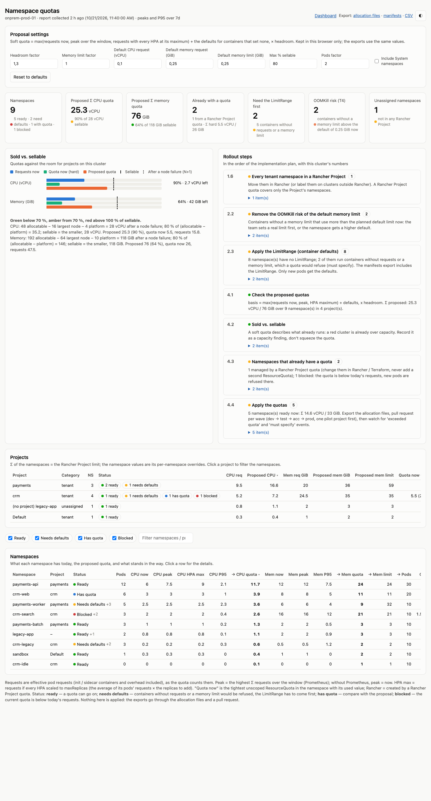

# Namespace quotas: from the as-is picture to a quota per namespace

The **Namespace quotas** page of the dashboard (`/quotas`, *Resource Allocation → Namespace quotas* in the
Rancher menu of every cluster) collects what you need to put a `ResourceQuota` and a `LimitRange` on each
namespace of that cluster, and proposes a first quota from what runs today. It is read-only: it applies nothing,
and the exports go through the allocation files and a pull request
([allocation as code](allocation-as-code.md)). It implements T1–T4 and T8 and steps 1.6–4.4 of the
[implementation plan](../docs/10-implementation-plan.md).



<sub>Synthetic demo data.</sub>

## What the page shows

| Section | Content |
|---|---|
| Proposal settings | Headroom factor, memory limit factor, the planned container defaults (LimitRange), the share of capacity that may be sold, the pods factor. Kept in your browser; the exports use the same values |
| Tiles | Namespaces by status, Σ proposed CPU and memory against what is sellable, namespaces that already have a quota, namespaces that need the LimitRange first, OOMKill risk (T4), unassigned namespaces |
| Sold vs. sellable | Per CPU and memory: requests now, today's quotas (hard) and the proposed quotas as bars; *sellable* and the room after a node failure as lines (T2) |
| Rollout steps | Steps 1.6, 2.2, 2.3, 4.1–4.4 of the implementation plan with this cluster's counts and the namespaces concerned |
| Projects | Per Rancher Project: Σ of its namespaces (= the Project limit), status counts, today's quotas. Click one to filter the namespaces |
| Namespaces | Per namespace: pods, requests now, peak, HPA maximum, usage, the proposed quota (bold), today's quota with its used share, the LimitRange defaults, containers without requests / memory limit / probably defaulted. Click a row for the calculation, the current objects and every issue |

Filter by status with the chips, or by name. The cluster selector appears when a report covers several clusters
(CLI collection); the in-cluster dashboard covers the cluster it runs in.

## The proposal

The soft quota of [step 4.1](../docs/10-implementation-plan.md#phase-4-soft-quotas-weeks-1016-per-environment):
generous enough that nothing running is squeezed, with room for rollouts and scale-outs.

```
basis            = max(requests now, peak Σ requests over the window, requests with every HPA at maxReplicas)
                   + what the LimitRange defaults add to containers that set no request
requests.cpu     = basis × headroom          rounded up to 0.1 vCPU, at least 0.1
requests.memory  = basis × headroom          rounded up to whole GiB, at least 1
limits.memory    = max(requests.memory × memory limit factor,
                       today's memory limits incl. the default limit × headroom)
pods             = pods now × pods factor    rounded up to 10, at least 10
```

| Input | Where it comes from | Notes |
|---|---|---|
| Requests now | Effective pod requests of running and pending pods (init / sidecar containers and overhead included), as the quota counts them | |
| Peak | The highest Σ requests over the window, from Prometheus (kube-state-metrics) | Without Prometheus, peak = now: scale-outs and cron jobs not running at collection time are not in the basis, the headroom has to cover them |
| HPA maximum (T8) | Per HPA, the average requests of its current pods × the replicas still to add, matched to the scale target by owner (a Deployment's ReplicaSet `<name>-<hash>`, a StatefulSet by name) | An HPA whose target has no pods adds nothing |
| Defaults | Containers without a CPU / memory request get the default request once the LimitRange exists, so they add to the requests; the namespace's own LimitRange values are used when it has one, else the planned ones from the settings | |
| Memory limits | Σ of today's memory limits plus the default limit for containers without one. A `limits.memory` quota below them refuses the next rollout, so the proposal is raised to cover them and the namespace gets a warning (limits far above requests break S3) | |

Namespaces without pods get the minimum. System namespaces (platform) are left out unless *Include System
namespaces* is ticked: they are the platform reserve, not something to sell.

## Status and issues

| Status | Meaning | What to do |
|---|---|---|
| **Ready** | A quota can go on; every container sets requests and a memory limit, or the namespace already has a LimitRange that fills them in | Export, pull request, apply per wave |
| **Needs defaults** | Containers without a request or a memory limit would be refused by the quota (*must specify requests.cpu*), there is no LimitRange yet | The LimitRange first (step 2.3; the manifests export includes it). Only new pods get the defaults |
| **Has quota** | A `ResourceQuota` exists. *Rancher* = created by a Rancher Project quota (namespace annotation `field.cattle.io/resourceQuota` or Rancher's label on the quota) | Compare with the proposal. A Rancher quota is changed in Rancher / Terraform, never doubled with a second ResourceQuota; a plain one is replaced through the allocation files |
| **Blocked** | The current quota is below today's requests: new pods are refused there now | Raise it first |

Issues shown with the status (click the row for the full list):

| Issue | Level | Meaning |
|---|---|---|
| Not in a Rancher Project | warning | Step 1.6: assign it first; a Rancher Project quota would not cover it |
| OOMKill risk (T4) | warning | A container without a memory limit uses more now than the planned default limit: it would be OOMKilled after its next restart (step 2.2). The snapshot comes from metrics-server; raise the default for that namespace or have the team set a limit |
| Quota ≥ 90 % used | warning | The alert threshold of step 1.3 |
| Memory limits above memory × factor | warning | The `limits.memory` proposal was raised to cover today's limits |
| Pending pods | note | They count against the quota |
| BestEffort pods | note | They get the defaults and become Burstable (S5) |
| Probably defaulted (T3) | note | Containers whose requests equal the LimitRange defaults: still to be set by the team |
| HPA maximum / peak above now | note | Included in the basis |
| No pods | note | Minimum quota; check whether the namespace is still needed |

## Sold vs. sellable (T2)

Per cluster and per CPU / memory:

```
room after a node failure = allocatable of schedulable nodes − largest node − platform requests   (N+1)
max % capacity            = max % × (allocatable − platform requests)
sellable                  = the smaller of the two
```

Green below 70 % of sellable, amber from 70 %, red above 100 %. A soft quota describes what already runs, so a red
cluster is already over capacity: record it as a capacity finding (step 4.2), don't squeeze the quota. The planners
use the same rule across all clusters, with the environment's node failures and maximum.

## Settings

| Setting | Default | Meaning |
|---|---|---|
| Headroom factor | 1.3 | Current footprint × 1.3 (step 4.1); rollout surge is inside it |
| Memory limit factor | 1 | `limits.memory` = `requests.memory` × factor: 1 in prod (S3), up to 2 elsewhere |
| Default CPU / memory request | 0.1 vCPU / 0.25 GiB | LimitRange `defaultRequest` for containers that set none ([02 default values](../docs/02-resource-standards.md#default-values-when-a-workload-does-not-specify)) |
| Default memory limit | 0.25 GiB | LimitRange `default.memory`; drives the OOMKill check (T4). No default CPU limit ([ADR-0003](../docs/adr/0003-cpu-limits.md)) |
| Max % sellable | 80 | Σ quota ≤ this share of the capacity after the platform reserve: 80 in prod, 100 in test, 150 in dev ([A2](../docs/09-operating-principles.md#a2-conservative-allocation)) |
| Pods factor | 2 | `pods` = pods now × 2, a guardrail that is not billed |
| Include System namespaces | off | Also list the platform namespaces |

Set them per cluster and environment: a dev cluster with factor 2 and 150 %, a prod cluster with 1 and 80 %.

## From the page to applied quotas

1. **Settle the list.** Work through the rollout steps on the page: assign unassigned namespaces (1.6), remove the
   OOMKill risks (2.2), decide the defaults (2.1).
2. **Export the allocation files** (*allocation files* link: one document per project with its namespaces on this
   cluster, with the numbers behind each value as comments, plus the `containerDefault` the proposal assumed).
   Put them in the allocations repository as `projects/<project>.yaml` and the defaults in `settings.yaml`
   ([allocation as code](allocation-as-code.md)). Namespaces that already have a quota and blocked ones are marked
   in the file.
3. **Check and generate**: `allocation/generate.py allocations --check` in the pull request, then `--out build`.
   For Rancher-managed clusters, Terraform `rancher2` takes the same numbers as Project limit (Σ) and namespace
   overrides ([step 3.2](../docs/10-implementation-plan.md#phase-3-allocation-as-code-weeks-310-parallel-to-phases-12));
   for clusters outside Rancher, apply the generated `ResourceQuota` and `LimitRange` per namespace.
4. **Apply per wave**, dev → test → acc → prod, one pilot project first; watch the *exceeded quota* and
   *must specify* events, pending pods and HPAs at their maximum (step 4.4). After the next collection the page
   shows the applied quotas under *Quota now* with their used share.

For a trial on a **test cluster** the *manifests* link gives the plain `ResourceQuota` `allocation` and
`LimitRange` `allocation-defaults` per namespace (same names and labels as `generate.py`; namespaces that already
have a quota are left out), to apply with `kubectl apply --server-side --field-manager=allocations -f`. Not on a
namespace with a Rancher Project quota.

The CSV has every number of the table, the current objects and the issues per namespace, for the baseline archive
of step 0.3.
